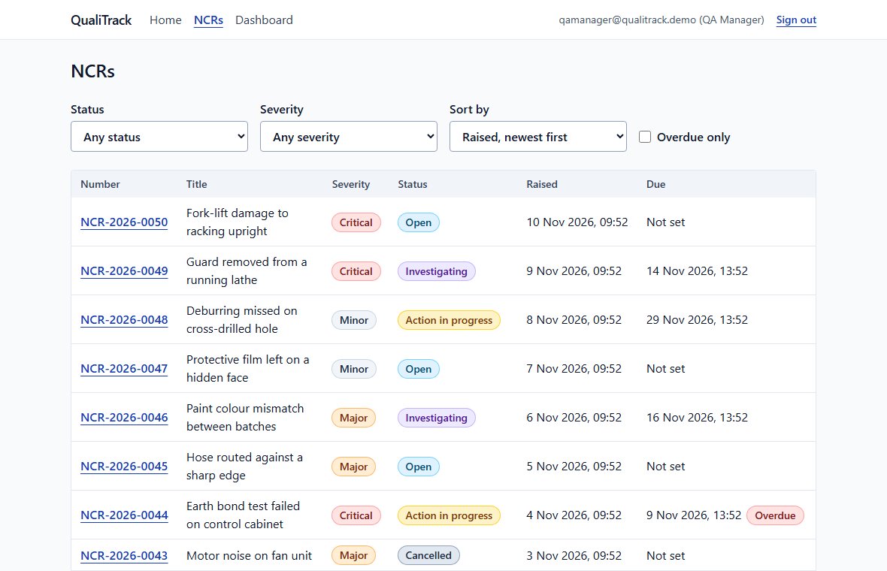
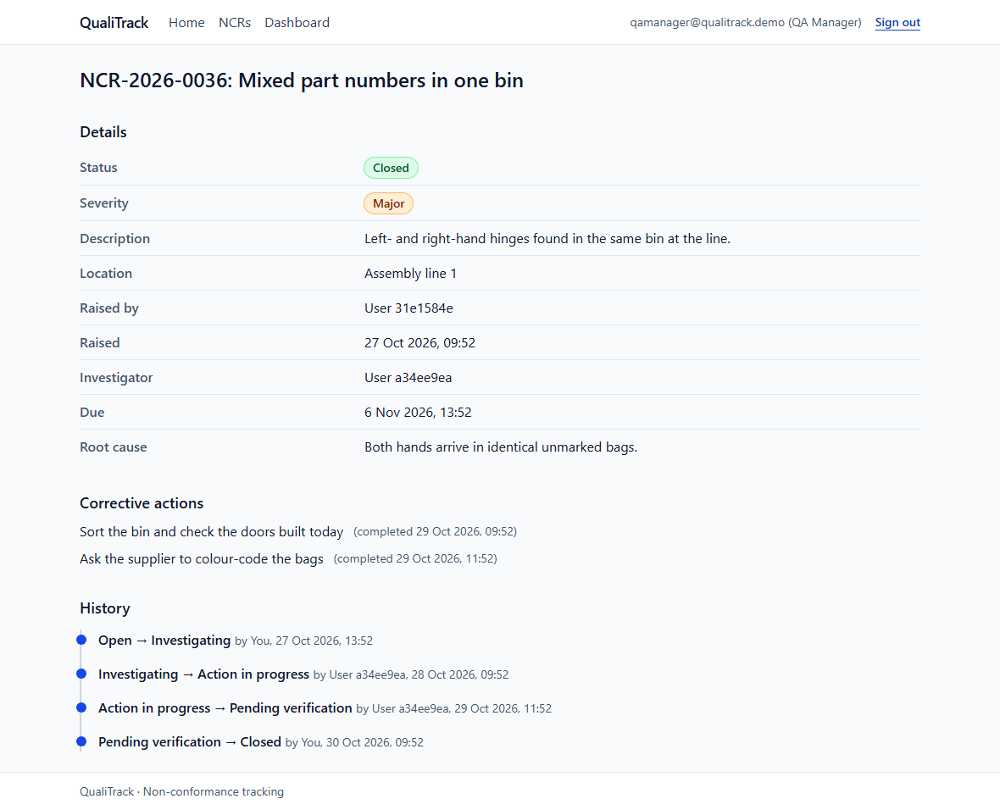
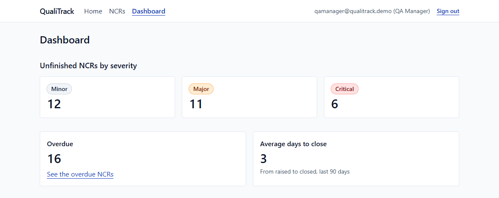
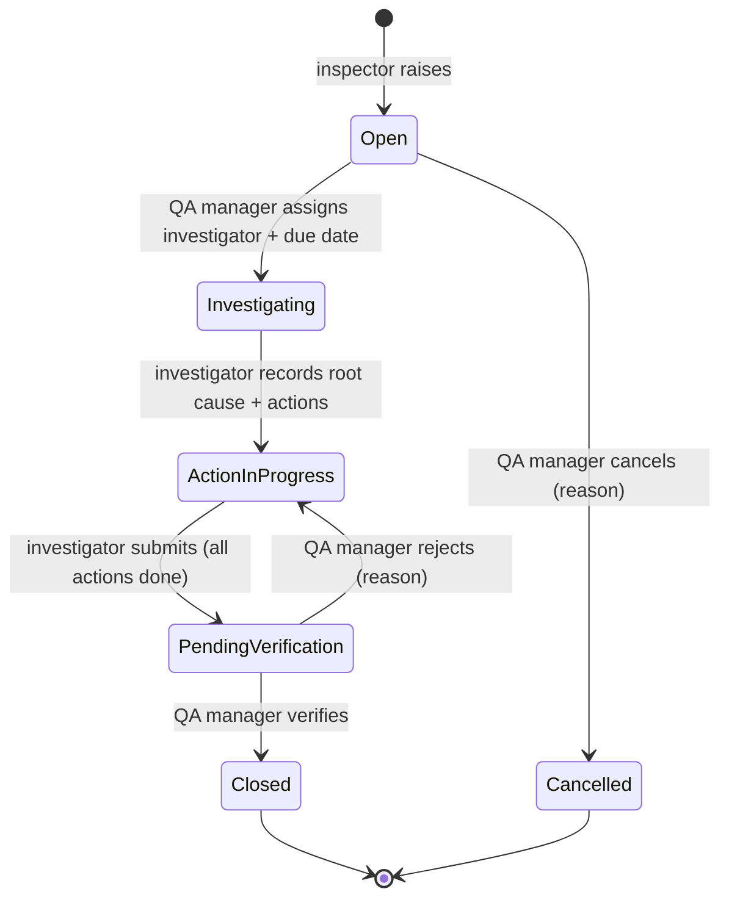
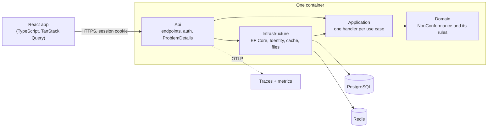

# QualiTrack

[](https://github.com/Winnie8596/qualitrack/actions/workflows/ci.yml)

**Track a quality problem from the moment it is reported until someone else has checked the fix.**
QualiTrack is a web app for non-conformance reports (NCRs) and their corrective actions: an inspector
reports a defect, a QA manager assigns it, an investigator records the cause and the fix, and a
different person verifies it before it closes. Every step is recorded with who and when.

Built with ASP.NET Core (.NET 10), PostgreSQL, Redis and React + TypeScript.

<!-- LIVE-DEMO -->
**Live demo:** not deployed yet. Run it locally with one command: see [Run it](#run-it).
<!-- /LIVE-DEMO -->



| One NCR, with its actions and history | The QA manager's dashboard |
| --- | --- |
|  |  |

## The problem

In many small manufacturers and contractors, NCRs live in Excel sheets, WhatsApp photos and paper
forms. So they get lost, or closed without anyone checking the fix; nobody can see which are
overdue; and when an auditor asks who did what and when (ISO 9001), there is no reliable answer.

QualiTrack puts the whole life of an NCR in one place and makes the invalid shortcuts impossible:
the person who did the fix cannot be the one who signs it off, and a closed NCR cannot be edited.

## The lifecycle



## The rules

Each rule lives in the domain model and has at least one unit test named after the behaviour.

| | Rule |
| --- | --- |
| BR-1 | An NCR needs a title, description, location, severity and the user who raised it. Blank text is rejected. |
| BR-2 | A critical NCR must be due within 7 days of being raised. A due date must be in the future. |
| BR-3 | Only the assigned investigator can record the root cause, add and complete actions, and submit. |
| BR-4 | An NCR can be submitted only with a root cause and every corrective action completed. |
| BR-5 | The verifier must be a different user from the investigator. |
| BR-6 | A closed or cancelled NCR cannot be changed. |
| BR-7 | Every status change records from, to, user, time and an optional note. Reject and cancel need a reason. |
| BR-8 | An NCR is overdue when its due date has passed and it is not closed or cancelled. |
| BR-9 | NCR numbers are unique and sequential per year: `NCR-2026-0001`. |

Who can do what: an **inspector** raises NCRs and sees their own; an **investigator** works on the
ones assigned to them; a **QA manager** sees everything, assigns, verifies, rejects, cancels and has
the dashboard.

## Architecture



Dependencies point inwards. `Domain` references nothing, not even a NuGet package; `Application`
declares the interfaces it needs (`INcrRepository`, `IClock`, `ICurrentUser` …) and `Infrastructure`
implements them. So the rules can be tested in milliseconds without a database, and nothing outside
the domain can change an NCR's status except by calling its methods.

A request, end to end: the endpoint maps JSON to a command, the handler checks the caller's role,
loads the NCR and calls one method on it with an `AuditStamp` (who, when); the entity enforces the
rules or throws; the handler turns that into a `Result`, and the API turns the result into a status
code and RFC 9457 ProblemDetails.

### Decisions

| ADR | Decision |
| --- | --- |
| [0001](docs/adr/0001-use-clean-architecture.md) | Clean architecture, dependencies pointing inwards |
| [0002](docs/adr/0002-business-rules-live-in-the-domain.md) | Business rules live only in the domain |
| [0003](docs/adr/0003-time-and-user-passed-into-the-domain.md) | Time and user are passed into the domain, never read by it |
| [0004](docs/adr/0004-testcontainers-over-in-memory-database.md) | Integration tests run against real PostgreSQL in Docker |
| [0005](docs/adr/0005-exceptions-inside-results-at-the-boundary.md) | Exceptions inside the domain, results at the handler boundary |
| [0006](docs/adr/0006-cookie-auth-over-jwt.md) | Session cookies rather than JWT |
| [0007](docs/adr/0007-tailwind-css-for-styling.md) | Tailwind CSS for styling |
| [0008](docs/adr/0008-react-router-for-routing.md) | React Router for routing |

Notes written along the way: [SQL indexes measured with `EXPLAIN ANALYZE`](docs/learning/sql-indexes.md),
[OWASP Top 10 and where each is defended](docs/learning/owasp-top-10.md), and the
[devlog](docs/devlog.md) of what each phase built, decided and learned.

## Run it

Prerequisite: Docker.

```bash
cp .env.example .env    # then change the passwords
docker compose up       # builds the image; the first run takes a few minutes
```

- **App:** https://localhost:8443. The browser warns once about the certificate, which comes from
  the local proxy's own authority. Sign in as `inspector@qualitrack.demo`,
  `investigator@qualitrack.demo` or `qamanager@qualitrack.demo` with the passwords from `.env`.
  It starts with 50 demo NCRs in every status.
- **Traces, metrics and logs:** http://localhost:18888 (Aspire Dashboard).

## Develop

Prerequisites: .NET 10 SDK, Node.js 22, Docker.

```bash
docker compose up -d db cache telemetry   # PostgreSQL, Redis and the telemetry viewer only
# export the "dotnet run only" and "Demo users" variables from .env, then:
dotnet run --project src/QualiTrack.Api --launch-profile https   # API on https://localhost:7178
cd web && npm ci && npm run dev                                   # web app on http://localhost:5173
```

## Testing

| Layer | What | How many | Run |
| --- | --- | ---: | --- |
| Domain | Every business rule, no database, no mocks | 126 | `dotnet test tests/QualiTrack.Domain.Tests` |
| Application | Every handler: success, not found, forbidden, conflict; hand-written fakes | 101 | `dotnet test tests/QualiTrack.Application.Tests` |
| API + database | Every endpoint over HTTP against real PostgreSQL (Testcontainers), including 400/401/403/404/409 | 220 | `dotnet test tests/QualiTrack.Api.IntegrationTests` |
| Components | Forms, pages and the API client in jsdom | 94 | `cd web && npm test` |
| Browser | The whole lifecycle per role, keyboard only, axe accessibility, 375 px layout | 9 | `cd web && npm run e2e` |

CI runs all of it on every pull request, builds the Docker image, and fails if line coverage drops
below 95 % for `Domain` or 85 % for `Application` (currently 98.8 % and 99.1 %). The build has
warnings as errors with the recommended analyzers on.

## Deployment

One image holds the API and the built web app. Pushing a tag `v*` runs
[`cd.yml`](.github/workflows/cd.yml): it builds the image, pushes it to GitHub Container Registry
and rolls it out to Azure Container Apps, which ends TLS in front of the container. The database is
Azure Database for PostgreSQL; secrets are Container Apps secrets, never in the repo.
[`infra/`](infra/) has the script that creates the Azure resources, and
[`uptime.yml`](.github/workflows/uptime.yml) checks `/health` on a schedule and emails on failure.

## What's next

- Email notifications when an NCR is assigned or rejected (a non-goal for v1)
- Azure Blob Storage behind `IFileStore` instead of a disk volume, so the app can run on several replicas
- Managed Redis in production; today a single replica caches the dashboard in memory
- Terraform for the Azure resources, with `terraform plan` on pull requests
- Names instead of ids in the history timeline, and a nightly reset of the public demo

## Docs

- [`PRD.md`](PRD.md): what is being built and why
- [`plan.md`](plan.md): order of work and engineering rules
- [`docs/adr/`](docs/adr/): architecture decision records
- [`docs/devlog.md`](docs/devlog.md): what each phase built, decided and learned
